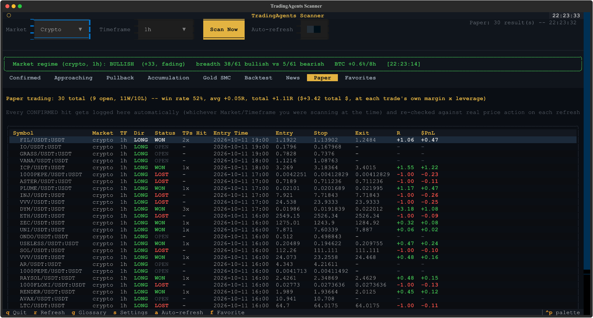
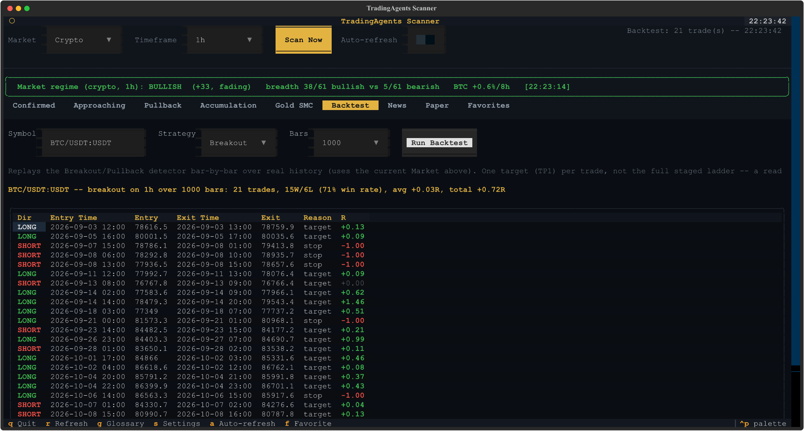
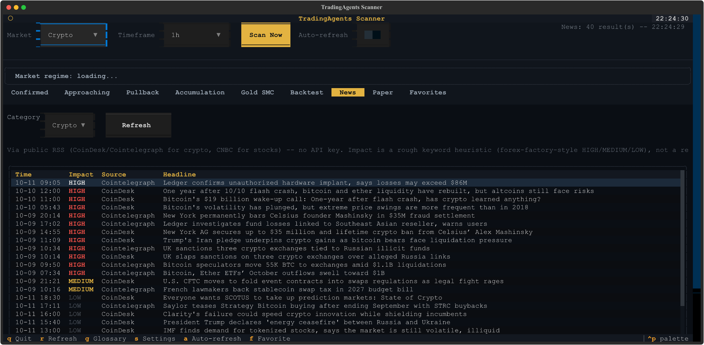
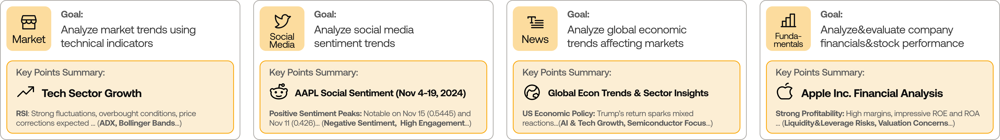

# Trading Scanner

A multi-market trading scanner with a live terminal dashboard (breakouts, pullbacks, accumulation ranges, SMC gold sweeps, market-wide regime, news, backtesting, and paper trading), built on top of [TradingAgents](https://github.com/TauricResearch/TradingAgents) — an open-source multi-agent LLM framework for deep, narrative stock analysis. The two tools solve different problems and both ship in this repo: the Scanner tells you **what's happening right now** across hundreds of symbols; TradingAgents tells you **why**, for one symbol at a time, through a simulated team of analyst/researcher/trader agents.

<p align="center">
  
</p>

> Everything here is a research and screening tool, not financial advice. Every signal is a candidate for your own further research, not an instruction to trade. See [`tauric.ai/disclaimer`](https://tauric.ai/disclaimer/) for the standard disclaimer that applies to the TradingAgents side of this project as well.

<div align="center">

📡 [Scanner & TUI](#scanner--tui) | 🤖 [TradingAgents Framework](#tradingagents-framework) | ⚡ [Installation](#installation) | 📦 [Package Usage](#python-usage) | 🤝 [Contributing](#contributing)

</div>

---

## Scanner & TUI

A live dashboard, built with [Textual](https://textual.textualize.io/), that scans crypto perpetuals, Binance's tokenized stock perpetuals, and real NASDAQ/NYSE stocks (via yfinance) for a handful of well-defined technical patterns — then backtests them against real history and paper-trades every live hit against what actually happened next, so the tool's own track record is something you can check rather than take on faith.

<p align="center">
  
</p>

### What it looks for

Every tier is bidirectional (long **and** short, clearly separated) unless noted:

- **Confirmed** — closed-candle, volume-confirmed breakouts/breakdowns, with entry/stop/staged TP1-TP2-TP3 targets.
- **Approaching** — the live, still-forming candle already building toward a breakout or breakdown, before it closes.
- **Pullback** — a retest of a level a recent breakout cleared, either holding (continuation) or failing (reversal).
- **Accumulation** — symbols basing in a tight, quiet range, watchlist-only (not a signal by itself).
- **Gold SMC** — a dedicated Smart Money Concepts liquidity-sweep analysis on XAU/USDT.
- **Market regime** — a standing bullish/neutral/bearish gauge blending breadth across ~60 liquid symbols with BTC's own trend, plus whether that lean is building, fading, or flipping. Context for every other tab, not a filter.
- **News** — crypto (CoinDesk/Cointelegraph) and stock (CNBC) headlines via public RSS, no API key, with a forex-factory-style HIGH/MEDIUM/LOW impact heuristic and a click-to-expand detail popup.

Every tier is a technical screener, not a predictor: it flags candidates that match a specific, documented pattern for you to research further, and says so in its own output. Press `g` in the TUI (or `--glossary` on the CLI) for a full plain-English explanation of every term it prints — RSI, ATR, score, R-multiple, and the rest.

### Does it actually work? (Backtest + Paper trading)

<p align="center">
  
</p>

- **Backtest tab** — replays the Breakout/Pullback detectors bar-by-bar over real paginated history for any symbol, using only data that would have been available at each point in time. Reuses the exact live detection code, so a backtest result means "this is what the live scanner would have shown," not a separate simulated version of the logic.
- **Paper tab** — logs every live `Confirmed` hit automatically and tracks it against real subsequent price action: a win stays open past TP1 to chase TP2/TP3, closing only once it reaches the final target or falls back through its original stop. Configurable margin and leverage (`s` for Settings) scale the $ P&L column only — never the R-multiple, which is what actually answers "does this detector have edge," independent of position size. This is the honest, slow answer to "does the system know if its own signals are right": not a one-off backtest, a ledger that keeps accumulating real outcomes the longer it runs. A handful of trades tells you almost nothing — treat the win rate as noise until it has weeks of real volume behind it, ideally spanning both a bullish and a bearish stretch.

### Running it

**Standalone, no Python needed:** grab the latest Windows `.exe` or Linux binary from the [Releases page](../../releases) and run it. On Linux: `chmod +x TradingScanner-linux && ./TradingScanner-linux`.

**From source:**
```bash
pip install .
python scanner_tui.py          # the TUI dashboard
python -m tradingagents.scanner.scan --help   # the CLI, for one-off scans and --watch mode
```

**Build your own executable** (see `TradingScanner.spec`, and `.github/workflows/build-tui.yml` for the CI version that builds both platforms on a tag push):
```bash
pip install pyinstaller
python -m PyInstaller TradingScanner.spec
```

### A few CLI examples

```bash
python -m tradingagents.scanner.scan --watch --approaching --pullback --regime
python -m tradingagents.scanner.scan --market stocks-real --timeframe 1d
python -m tradingagents.scanner.scan --paper-trade --paper-leverage 3 --paper-notional 25
python -m tradingagents.scanner.scan --gold-smc --watch
```

(Backtesting is TUI-only for now — open the Backtest tab, pick a symbol/strategy/bar count, and press Run Backtest.)

Run `python -m tradingagents.scanner.scan --help` for the full set of flags — every tier, both market modes, and the paper-trading options are documented inline there.

---

## TradingAgents Framework

TradingAgents is a multi-agent trading framework that mirrors the dynamics of real-world trading firms. By deploying specialized LLM-powered agents — fundamental analysts, sentiment experts, technical analysts, traders, and a risk management team — it collaboratively evaluates market conditions and produces a narrative trading decision for one ticker and date at a time. This is the part of the project inherited from the original [TauricResearch/TradingAgents](https://github.com/TauricResearch/TradingAgents); see [`CHANGELOG.md`](CHANGELOG.md) for its release history.

<p align="center">
  
</p>

### Analyst Team
- **Fundamentals Analyst** — evaluates company financials and performance metrics, identifying intrinsic values and potential red flags.
- **Sentiment Analyst** — aggregates news headlines, StockTwits, and Reddit chatter into a single sentiment read.
- **News Analyst** — monitors global news and macroeconomic indicators, interpreting the impact of events on market conditions.
- **Technical Analyst** — uses technical indicators (like MACD and RSI) to detect trading patterns and forecast price movements.

<p align="center">
  
</p>

### Researcher Team
Bullish and bearish researchers critically assess the Analyst Team's findings through structured debate, balancing potential gains against inherent risks.

<p align="center">
  
</p>

### Trader Agent
Composes reports from the analysts and researchers into a trading decision — timing and sizing.

<p align="center">
  
</p>

### Risk Management and Portfolio Manager
The risk team continuously evaluates volatility, liquidity, and other risk factors, adjusting strategy and reporting to the Portfolio Manager, who approves or rejects the final proposal.

<p align="center">
  
</p>

## Installation

```bash
git clone https://github.com/Annor-Gyimah/Trading-Scanner.git
cd Trading-Scanner

conda create -n tradingagents python=3.12   # or any env manager you prefer
conda activate tradingagents

pip install .
```

### Docker (TradingAgents framework only)

```bash
cp .env.example .env  # add your API keys
docker compose run --rm tradingagents
```

For local models with Ollama:
```bash
docker compose --profile ollama run --rm tradingagents-ollama
```

### Required APIs (TradingAgents framework only — the Scanner needs no API keys)

TradingAgents supports multiple LLM providers. Set the API key for your chosen provider:

```bash
export OPENAI_API_KEY=...          # OpenAI (GPT)
export GOOGLE_API_KEY=...          # Google (Gemini)
export ANTHROPIC_API_KEY=...       # Anthropic (Claude)
export XAI_API_KEY=...             # xAI (Grok)
export DEEPSEEK_API_KEY=...        # DeepSeek
export DASHSCOPE_API_KEY=...       # Qwen — International (dashscope-intl.aliyuncs.com)
export DASHSCOPE_CN_API_KEY=...    # Qwen — China (dashscope.aliyuncs.com)
export ZHIPU_API_KEY=...           # GLM via Z.AI (international)
export ZHIPU_CN_API_KEY=...        # GLM via BigModel (China, open.bigmodel.cn)
export MINIMAX_API_KEY=...         # MiniMax — Global (api.minimax.io)
export MINIMAX_CN_API_KEY=...      # MiniMax — China (api.minimaxi.com)
export OPENROUTER_API_KEY=...      # OpenRouter
export ALPHA_VANTAGE_API_KEY=...   # Alpha Vantage
```

For Azure OpenAI, copy `.env.enterprise.example` to `.env.enterprise` and fill in your credentials.

For AWS Bedrock, install the extra with `pip install ".[bedrock]"`, set `llm_provider: "bedrock"`, configure AWS credentials (environment variables, `~/.aws/credentials`, or an IAM role) and `AWS_DEFAULT_REGION`, and use a Bedrock model ID, e.g. `us.anthropic.claude-opus-4-8-v1:0`.

For local models, configure Ollama with `llm_provider: "ollama"`. The default endpoint is `http://localhost:11434/v1`; set `OLLAMA_BASE_URL` to point at a remote `ollama-serve`. Pull models with `ollama pull <name>`, and pick "Custom model ID" in the CLI for any model not listed by default.

For any other OpenAI-compatible server (vLLM, LM Studio, llama.cpp, or a custom relay), use `llm_provider: "openai_compatible"` and set the endpoint via `backend_url` (or `TRADINGAGENTS_LLM_BACKEND_URL`), e.g. `http://localhost:8000/v1` for vLLM or `http://localhost:1234/v1` for LM Studio. No key is needed for local servers; set `OPENAI_COMPATIBLE_API_KEY` when the endpoint requires one.

Alternatively, copy `.env.example` to `.env` and fill in your keys:
```bash
cp .env.example .env
```

### TradingAgents CLI Usage

Launch the interactive CLI:
```bash
tradingagents          # installed command
python -m cli.main     # alternative: run directly from source
```
You will see a screen where you can select your desired tickers, analysis date, LLM provider, research depth, and more.

### Markets and tickers (TradingAgents framework)

TradingAgents works with any market Yahoo Finance covers, using the exchange-suffixed ticker. Company identity and the alpha benchmark resolve automatically per market.

- US: `AAPL`, `SPY`
- Hong Kong: `0700.HK` · Tokyo: `7203.T` · London: `AZN.L`
- India: `RELIANCE.NS`, `.BO` · Canada: `.TO` · Australia: `.AX`
- China A-shares: Shanghai `.SS`, Shenzhen `.SZ` (e.g. `600519.SS` for Kweichow Moutai)
- Crypto: `BTC-USD`, `ETH-USD`

<p align="center">
  
</p>

An interface will appear showing results as they load, letting you track the agent's progress as it runs.

<p align="center">
  
</p>

<p align="center">
  
</p>

## Python Usage

Both the Scanner and TradingAgents are usable as plain Python libraries.

### Scanner

```python
from tradingagents.scanner import scan, run_backtest, evaluate_market_regime

results = scan(timeframe="1h", market="crypto", top_n=15)   # Confirmed breakouts/breakdowns
regime = evaluate_market_regime()                            # bullish/neutral/bearish gauge
backtest = run_backtest("BTC/USDT:USDT", timeframe="1h", strategy="breakout", total_bars=1000)
print(backtest.win_rate, backtest.avg_r)
```

### TradingAgents

Import the `tradingagents` module and initialize a `TradingAgentsGraph()` object. The `.propagate()` function returns a decision. You can also run `main.py` directly, or:

```python
from tradingagents.graph.trading_graph import TradingAgentsGraph
from tradingagents.default_config import DEFAULT_CONFIG

ta = TradingAgentsGraph(debug=True, config=DEFAULT_CONFIG.copy())

# forward propagate
_, decision = ta.propagate("NVDA", "2026-01-15")
print(decision)
```

You can also adjust the default configuration to set your own choice of LLMs, debate rounds, etc.

```python
from tradingagents.graph.trading_graph import TradingAgentsGraph
from tradingagents.default_config import DEFAULT_CONFIG

config = DEFAULT_CONFIG.copy()
config["llm_provider"] = "openai"        # e.g. openai, google, anthropic, deepseek, groq, ollama; openai_compatible covers any OpenAI-compatible endpoint (vLLM, LM Studio, llama.cpp, ...)
config["deep_think_llm"] = "gpt-5.5"     # Model for complex reasoning
config["quick_think_llm"] = "gpt-5.4-mini" # Model for quick tasks
config["max_debate_rounds"] = 2

ta = TradingAgentsGraph(debug=True, config=config)
_, decision = ta.propagate("NVDA", "2026-01-15")
print(decision)
```

See `tradingagents/default_config.py` for all configuration options.

## Persistence and Recovery (TradingAgents framework)

TradingAgents persists two kinds of state across runs.

### Decision log

The decision log is always on. Each completed run appends its decision to `~/.tradingagents/memory/trading_memory.md`. On the next run for the same ticker, TradingAgents fetches the realised return (raw and alpha vs SPY), generates a one-paragraph reflection, and injects the most recent same-ticker decisions plus recent cross-ticker lessons into the Portfolio Manager prompt, so each analysis carries forward what worked and what didn't.

Override the path with `TRADINGAGENTS_MEMORY_LOG_PATH`.

### Checkpoint resume

Checkpoint resume is opt-in via `--checkpoint`. When enabled, LangGraph saves state after each node so a crashed or interrupted run resumes from the last successful step instead of starting over. On a resume run you will see `Resuming from step N for <TICKER> on <date>` in the logs; on a new run you will see `Starting fresh`. Checkpoints are cleared automatically on successful completion.

Per-ticker SQLite databases live at `~/.tradingagents/cache/checkpoints/<TICKER>.db` (override the base with `TRADINGAGENTS_CACHE_DIR`). Use `--clear-checkpoints` to reset all of them before a run.

```bash
tradingagents analyze --checkpoint           # enable for this run
tradingagents analyze --clear-checkpoints    # reset before running
```

```python
config = DEFAULT_CONFIG.copy()
config["checkpoint_enabled"] = True
ta = TradingAgentsGraph(config=config)
_, decision = ta.propagate("NVDA", "2026-01-15")
```

The Scanner keeps its own, separate persistence: favorites at `~/.tradingagents/favorites.json` and the paper-trading ledger at `~/.tradingagents/paper_trades.db` (a small SQLite file — override with `TRADINGAGENTS_PAPER_DB`, mainly useful for testing without touching your real ledger).

## Reproducibility (TradingAgents framework)

TradingAgents is LLM-driven, so two runs of the same ticker and date can differ. This is expected for a research tool built on language models, not a defect. The variation comes from a few distinct sources, and it helps to separate them.

Language model sampling is non-deterministic. Even at a fixed temperature, providers do not guarantee byte-identical output across calls, and reasoning models (the default GPT-5.x family, and any thinking-mode model) vary the most because their internal reasoning is itself sampled.

Live data moves. News, StockTwits, and Reddit return different content as time passes, so a run today sees different inputs than a run last week even for the same historical trade date. Pin the analysis date to hold the price and indicator window fixed, but the social and news sources still reflect "now".

To reduce variation you can lower the sampling temperature. Set `temperature` in your config (or `TRADINGAGENTS_TEMPERATURE` in `.env`); lower values make models that honor it more repeatable. The current curated models are reasoning-first and largely ignore temperature, so for tighter reproducibility use a non-reasoning model, which you can set explicitly via the Custom model ID option.

```python
config = DEFAULT_CONFIG.copy()
config["llm_provider"] = "openai"
config["temperature"] = 0.0
# Reasoning models ignore temperature. For tighter reproducibility, set a
# non-reasoning deep/quick model explicitly (e.g. via the Custom model ID option).
```

What does not vary anymore: the analyzed company identity is resolved deterministically from the ticker before any agent runs, and the market analyst grounds exact price and indicator claims in a verified data snapshot.

Backtest results (for either the Scanner or the TradingAgents framework) are not guaranteed to match any published figure. Treat both as research scaffolds for studying detection logic and multi-agent analysis, not as a strategy with a fixed, replicable return.

## Contributing

Contributions are welcome: bug fixes, documentation, and feature ideas. Past TradingAgents-framework contributions are credited per release in [`CHANGELOG.md`](CHANGELOG.md).

## Credits & Citation

The Scanner, its TUI, backtesting, and paper-trading ledger are original work added in this repository. The TradingAgents multi-agent framework is from [TauricResearch/TradingAgents](https://github.com/TauricResearch/TradingAgents); please cite their work if you find it useful:

```
@misc{xiao2025tradingagentsmultiagentsllmfinancial,
      title={TradingAgents: Multi-Agents LLM Financial Trading Framework}, 
      author={Yijia Xiao and Edward Sun and Di Luo and Wei Wang},
      year={2025},
      eprint={2412.20138},
      archivePrefix={arXiv},
      primaryClass={q-fin.TR},
      url={https://arxiv.org/abs/2412.20138}, 
}
```
